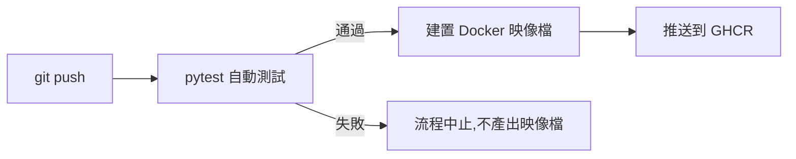

# devops-mini

一個迷你 CI/CD 專案:push 程式碼後,自動測試、建置 Docker 映像檔並推送到 GitHub Container Registry。


## 專案目的

練習 DevOps 核心流程:把「手動測試、手動打包」變成「push 之後全自動」。

## 流程



## 技術組成

| 項目       | 工具                                  |
| ---------- | ------------------------------------- |
| 應用程式   | Python Flask + gunicorn               |
| 測試       | pytest                                |
| 容器化     | Docker(python:3.12-slim,非 root 執行) |
| CI/CD      | GitHub Actions                        |
| 映像檔倉庫 | GHCR                                  |

## 如何在本機執行

```bash
docker run -p 5000:5000 ghcr.io/bobokaikai/devops-mini:latest
```

打開 http://localhost:5001 ,`/health` 可做健康檢查。

## 設計決策

- **多個 job 串接(`needs: test`)**:測試失敗就不建置,避免壞掉的版本進到倉庫
- **只在 push 到 main 時推送映像檔**:pull request 只跑測試
- **映像檔同時標記 `latest` 與 commit SHA**:可以追溯每個映像檔對應哪次提交
- **使用內建的 `GITHUB_TOKEN`,最小權限**:不需要把任何機密放進程式碼
- **容器內不使用 root**:基本安全實務
- **先複製 requirements.txt 再安裝套件**:利用 Docker 快取加速建置

## 成果

- 映像檔大小:【172】MB(`python:3.12-slim`)
- 流程時間:push 到映像檔上線約【1】分鐘(看 Actions 頁面)

<!-- ## 失敗案例:測試如何攔下錯誤

故意把回傳文字改錯後,CI 自動失敗,不會產出映像檔:


修正後恢復正常:

 -->

## 學習過程中遇到的問題

- 本機測試曾因回傳文字拼字差異而失敗,測試立即抓出問題
- `docker run` 少打一個 `-` 導致找不到映像檔,學到埠號對應格式是「本機埠:容器埠」
- 【之後遇到新問題就加在這裡】

## 未來改進

- [ ] 加入 Trivy 映像檔安全掃描
- [ ] 改用 multi-stage build,比較映像檔大小
- [ ] 部署到本機 Kubernetes(kind)並用 Argo CD 做 GitOps
- [ ] 加入 Prometheus + Grafana 監控
